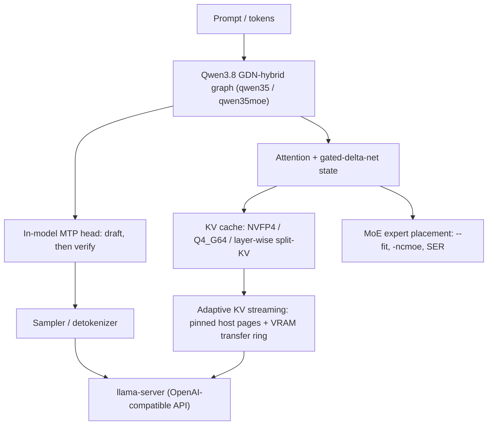

<div align="center">

# den_llama.cpp

**A llama.cpp fork engineered for one job: Qwen3.8-27B at up to 196K context with native MTP speculative decoding on a single 16 GB GPU, plus a MoE serving lane on the same card.**

[](LICENSE)
[](#architecture)
[](#architecture)
[](#architecture)
[](#status)

<sub>
<a href="#architecture">Architecture</a> &middot;
<a href="#engine-internals">Engine internals</a> &middot;
<a href="#benchmarks">Benchmarks</a> &middot;
<a href="#status">Status</a> &middot;
<a href="#models">Models</a> &middot;
<a href="#quick-start">Quick start</a> &middot;
<a href="#credits">Credits</a>
</sub>

</div>

---

The reference target is one NVIDIA Blackwell GPU (RTX 5070 Ti, GB203, sm_120a, 16 GB) running Qwen3.8-27B with an in-model multi-token-prediction (MTP) head. The fork carries a frozen reference engine (`build2`) and a development engine (`build3`). It is the neural execution engine of [Project Den](https://github.com/RentedNoodle/Project_Den).

## Architecture



The engine schedules four scarce resources at once on one card: model weights, KV state, expert bank placement, and speculative draft work. Each is described under Engine internals below.

## Engine internals

<details>
<summary>NVFP4 weights on Blackwell tensor cores</summary>

The CUDA backend carries the NVFP4 weight type and the Blackwell block-scaled matrix-multiply path. On sm_120a the 4-bit path runs through the `mxf4nvf4` block-scaled MMA with UE4M3 block scales (`mma.sync.aligned.kind::mxf4nvf4.block_scale.scale_vec::4X.m16n8k64`), selected per architecture in `ggml/src/ggml-cuda/mma.cuh` and configured in `mmq-config-blackwell.cuh`, with the NVFP4 MMQ instance in `template-instances/mmq-instance-nvfp4.cu`. The tensor cores do the dequantize-multiply without a separate materialization pass.

</details>

<details>
<summary>Quantized KV cache: NVFP4, Q4_G64, and layer-wise split-KV</summary>

The KV cache is a first-class memory lever. `GGML_TYPE_NVFP4` is usable as a KV type (matched and mixed pairs, KLD 0.0151 against a q4_0 control). `GGML_TYPE_Q4_G64` is a signed INT4 codec with one FP16 scale per 64 values (4.25 bpv) whose quantizer and dequantizer are unit-verified byte- and bit-exact against a CPU reference (KLD 0.0163). `--kv-high-precision-layers N` keeps the first N full-attention layers on `-ctk`/`-ctv` and drops the rest to NVFP4, so precision sits where the model needs it while memory comes back elsewhere.

</details>

<details>
<summary>Speculative MTP: in-model draft then verify</summary>

Speculative decoding uses the model's own MTP (NextN) head: the head proposes draft tokens and the trunk verifies them, with no separate draft model. The pinned golden master adds a carryover-reset fix (`common/speculative.cpp`: stale `pending_h`/`verify_h` are zeroed on a new prompt) and server-side hidden-state plumbing (`--embeddings-nextn`, `llama_set_embeddings_nextn()`, a per-token `h_nextn` in the non-OAI embeddings JSON). The ship GGUF pairs the IQ3_XXS trunk with a `Q6_K` MTP draft head.

</details>

<details>
<summary>Expert staging for MoE models</summary>

The MoE lane places experts across CPU and GPU instead of keeping the full expert bank resident. A MoE-aware margin cap in `common/fit.cpp` makes `--fit on` (without `-ngl`) land experts in the fast zone on a 16 GB card. `-ncmoe` moves a chosen number of expert layers to CPU, and partial offload overlaps and beats full residency by about 8x on a 26B-A4B. Smart Expert Reduction (SER, `-ser MIN,THRESH`, `--ser-top-p`, `--ser-ramp`) is a dense-sanitized expert-reduction instrument in `mmid.cu`, `mmq.cu`, `mmf.cu`, `mmvq.cu`, and `quantize.cu`; it also root-caused a `mm_ids_helper` density-invariant CUDA fault inherited from the reference implementation.

</details>

<details>
<summary>Long-context placement on one card</summary>

Two mechanisms hold long context on 16 GB. Adaptive KV streaming (`--kv-stream-stage-mib N`) keeps the authoritative KV tensors in pinned host memory with a bounded CUDA pool shared by resident pages and a transfer ring; the runtime grows the resident split as budget allows and prefetches later layers while the current layer computes. The KV headroom guard (`--kv-headroom-warn/-block/-force`) projects free device memory at context creation and surfaces the VRAM-ceiling cliff (a silent prefill collapse today), naming the maximum safe context. Together they are what lets the engine hold a 196K context window on one card. That is a capacity and placement result, not a deep-recall measurement; deep recall is measured separately under Benchmarks.

</details>

## Benchmarks

Only golden-build (`build2`) numbers with recorded conditions are listed. FA-quant-pair numbers are labeled **experiment (build-fa, not golden)**. Numbers whose conditions are not fully pinned (GPQA-Diamond, toolcall) are intentionally omitted; see the model repo for those.

> [!NOTE]
> Context capacity is not recall. The 196K figure is context-window capacity on a 16 GB card (adaptive KV streaming plus the KV headroom guard; receipt `SHIPPABLE_Q4_RESIDENT.md`). Deep-recall quality is measured separately. The needle result below is 6/6 on a 15K-word haystack, the largest verified retrieval window in-repo; there is no 196K-needle result here. Windowed recall runs exist experimentally, are query-dependent, and are not recommended for deep recall. Receipts with raw conditions: `BUILD2_GOLDEN.md`, `SHIPPABLE_Q4_RESIDENT.md`, `DEN.md`; full eval logs ship in the model repo's `evals/`.

| Metric | Value | Conditions |
|---|---|---|
| Needle retrieval | **6/6** | golden build2; `Qwen3.8-27B-OrcaRouter-GSQ-RCO-IQ3_XXS-v2.0.gguf`; 15K-word haystack, depths 0.1-0.9, temp 0.0.[1] |
| WikiText-2 perplexity | **6.1745 +/- 0.14889** | golden build2 `llama-perplexity.exe`; ship file; 40x512 chunks; `-fa on`; KV default (no `-ctk`/`-ctv` passed).[2] |
| Serve t/s @ 32K ctx | **82.73 t/s** (median; 79.4-89.6) | golden build2; ctx 32768; 5 prompts x 300 tok x 2 reps; temp 0.6; seed 424242; np=1; MTP n-max 2; accept 0.6703; prefill 706 t/s.[3] |
| Serve t/s @ 65K ctx | **64.16 t/s** (median ALL; 51.11-72.48) | golden build2 (FA A/B control); ship file; ctx 65536; `-b 2048 -ub 2048 -fa on -ctk q8_0 -ctv q4_0 -ngl 99 -t 8 -tb 8`; MTP n-max 2; median accept ALL 0.7675 / CUM 0.7010.[4] |
| FA build, t/s | **79.48 t/s** (median) | *experiment (build-fa, not golden)*: HEAD `abd589d4c` plus `fa_fix.diff`; same flags as the 65K control; +23.9% vs control.[5] |
| FA build, acceptance | **0.7018 ALL / 0.6768 CUM** | *experiment (build-fa, not golden)*; control 0.7675 / 0.7010.[5] |
| FA build, ppl / needle | **6.1745 +/- 0.14889 / 6/6** | *experiment (build-fa, not golden)*; ppl delta 0.00% vs control; control needle 5/6 (needle-05 miss).[5] |

### build3 (working engine) additions

| Metric | Value | Conditions |
|---|---|---|
| NVFP4 KV, decode / KLD | **88.6 t/s / 0.0151** | build3; matched `-ctk nvfp4 -ctv nvfp4`; vs q4_0-KV control (KLD 0.104 bound); about 1 GiB KV saved @131K.[6] |
| Q4_G64 KV, NIAH / KLD | **6/6 / 0.0163** | build3 `feat/q4-g64-kv`; matched and mixed pairs; unit harness: quantizer byte-identical vs CPU ref, dequant bit-identical.[7] |
| Layer-wise split-KV, NIAH | **6/6** | build3; `--kv-high-precision-layers 8` @64K; prefill 1059 t/s.[8] |
| MoE 26B-A4B, decode (offload) | **94-117 t/s** | build3; gemma-4-26B-A4B Q4_K_M; `-ncmoe 4` (full-resident collapses to 11-15 t/s at the VRAM ceiling).[9] |
| MoE KV x offload, decode | **129 t/s** | build3; `-ctk q8_0 -ctv q4_0 -ncmoe 2` (+11% vs f16/ncmoe4); knife-edge: 6 MiB more VRAM (ncmoe 1) collapses to 21.5 t/s.[10] |
| KV headroom guard | **verified** | build3; dense 32K gives 4585 MiB free (clean); dense 196K gives 653 MiB free, warns and reports max safe ctx; offloaded MoE is accurate, warn-only.[11] |

Notes from building these:

- **V precision vs MTP acceptance is context-state dependent.** With a fixed prompt and seed on a fresh short context the figure is stable (q4_0 V 0.7563 vs q8_0 V 0.7417, identical across runs), but after a long-context ingest the direction flips (q8_0 V 0.819 vs q4_0 V 0.742). Pick V precision per deployment by measuring; q8_0 V fits at or below 64K, q4_0 V for long context.
- **MoE with CUDA graphs is high-risk.** Dynamic expert destinations break capture and replay stale pointers. Capture dense-lane graphs only, if at all.
- **Thread count does not move the MoE offload path** (114-117 t/s across `-t 4/8/16`).
- **Each result was reproduced on the same card.** Numbers without recorded conditions are not listed.

[1] Model card (Hugging Face / ModelScope).
[2] Project perplexity log (build2 `llama-perplexity.exe`, 40x512-chunk run on the ship file).
[3] Project A/B record: model file at run time was `...v2.0-s1-orcaim.gguf`, later consolidated into `v2.0.gguf`; short-ctx KV type was not recorded in the AB source.
[4] FA A/B battery log (control leg, median-of-3).
[5] Project FA A/B verdict record section 2. Disposition: the pre-registered gate recorded TESTED-NEGATIVE (acceptance CUM -0.0242, exceeding the 0.02 bound) and build2 stayed golden; on 2026-09-10 an executive override promoted build-fa to >128K-regime golden, retaining build2 as the immutable at-or-below-128K default (override record).
[6] NVFP4-KV validation record (`docs/superpowers/specs/2026-09-24-nvfp4-kv-validated.md`).
[7] Q4_G64 record (`.../2026-09-24-q4-g64-kv-type.md`) and unit harness.
[8] Split-KV record (`.../layer-wise-split-kv.md`, 64K needle result).
[9] MoE placement record (`.../2026-09-24-moe-expert-placement-build3.md`).
[10] KV x MoE record (`.../2026-09-24-kv-moe-interaction.md`).
[11] Headroom-guard commits `c1a0fa815` and `9cd4febbb`.

## Status

| Label | Meaning |
|---|---|
| Built | code exists and is tested |
| Prototype | runs, unstable |
| Spec | design only |
| Hypothesis | untested idea |

| Component | Status |
|---|:--:|
| Reference engine (build2, Qwen3.8-27B plus MTP) | Built |
| Development engine (build3) | Built |
| Quantized KV cache (NVFP4, Q4_G64) | Built |
| Layer-wise split-KV | Built |
| KV headroom guard | Built |
| MoE expert placement (`--fit`, `-ncmoe`) | Built |
| Smart Expert Reduction (SER) | Built |
| MTP speculative decode | Built |
| Adaptive KV streaming | Prototype |
| FlashAttention quant-pair enablement | Prototype |
| NVFP4 weight MMA on Blackwell tensor cores | Prototype |

## Models

All repos verified live via the Hugging Face and ModelScope public APIs.

| Artifact | File | Size | SHA256 (prefix) |
|---|---|---|---|
| Main quant, [Hugging Face](https://huggingface.co/RentedNoodle/Qwen3.8-27B-OrcaRouter-GSQ-RCO-IQ3_XXS-Uncensored) &middot; [ModelScope](https://modelscope.cn/models/RentedNoodle/Qwen3.8-27B-OrcaRouter-GSQ-RCO-IQ3_XXS-Uncensored) | `Qwen3.8-27B-OrcaRouter-GSQ-RCO-IQ3_XXS-v2.0.gguf` | 10,466,439,424 B (9.75 GiB) | `41ad7dfb...` |
| Vision projector (BF16) | `mmproj/mmproj-Qwen3.8-27B-BF16.gguf` | 931,146,528 B (about 0.87 GiB) | `13cb7beb...` |
| Vision projector (Q8_0) | `mmproj/mmproj-Qwen3.8-27B-Q8_0.gguf` | 629,247,648 B (about 0.60 GiB) | `b280c2cb...` |
| Chat template | `froggeric-qwen3.8-tool-use.jinja` | 28,234 B | `e57684ba...` |
| RCO allocation map | `REF-IQ3_XXS-mtp.rco-allocation.txt` | 24,583 B | `2e690030...` |
| imatrix | `imatrix.dat` | 13,642,656 B | `e0fcab28...` |

Base and reference repos: [`orcarouter/Qwen3.8-27B-Uncensored`](https://huggingface.co/orcarouter/Qwen3.8-27B-Uncensored) (uncensored base), [`Qwen/Qwen3.8-27B`](https://huggingface.co/Qwen/Qwen3.8-27B) (architecture and pretrained weights), [`ISTA-DASLab/Qwen3.8-27B-GSQ-RCO-GGUF`](https://huggingface.co/ISTA-DASLab/Qwen3.8-27B-GSQ-RCO-GGUF) (RCO allocation source), [`froggeric/Qwen-Fixed-Chat-Templates`](https://huggingface.co/froggeric/Qwen-Fixed-Chat-Templates) (tool-use template). All hashes are from the model repo's `SHA256SUMS.txt`; `REF-...` and `imatrix.dat` prefixes are from the upload record.

## Quick start

### Golden build (Windows, CUDA 13.3 + VS2022 + Ninja)

Pin the golden master commit, then configure with `GGML_CUDA_FA_ALL_QUANTS=OFF` (the value the golden `build2` was built with):

```powershell
git clone https://github.com/RentedNoodle/den_llama.cpp.git
cd den_llama.cpp
git checkout abd589d4cf6d4d2d221b9532d3861fadbdb7b046

cmake -S . -B build2 -G Ninja `
  -DCMAKE_BUILD_TYPE=Release `
  -DGGML_CUDA=ON `
  -DGGML_CUDA_FA_ALL_QUANTS=OFF `
  -DGGML_CUDA_GRAPHS=ON `
  -DGGML_CUDA_NCCL=ON `
  -DGGML_CUDA_COMPRESSION_MODE=size `
  -DGGML_NATIVE=ON `
  -DGGML_LLAMAFILE=ON `
  -DGGML_OPENMP=ON `
  -DGGML_CPU_REPACK=ON `
  -DGGML_BUILD_EXAMPLES=OFF `
  -DGGML_BUILD_TESTS=OFF

cmake --build build2 --target llama-server --config Release -j 8
```

### Ship command (RTX 5070 Ti 16 GB)

```powershell
build2\bin\llama-server.exe `
  -m Qwen3.8-27B-OrcaRouter-GSQ-RCO-IQ3_XXS-v2.0.gguf `
  --spec-type draft-mtp --spec-draft-n-max 2 `
  --ctx-size 262144 -fa on -ctk q8_0 -ctv q4_0 -ngl all `
  -b 512 -ub 512 -np 1 --kv-stream-stage-mib 2048 `
  -t 8 -tb 8 --cache-ram 8192 --reasoning-budget 256
```

For depth-0.5 retrieval fidelity, use `-b 2048 -ub 2048` (a documented chunking artifact of the model, not this fork).

### Build3 (working engine)

`build3` is source-compatible with the ship command above and adds:

```powershell
# quantized KV + split-KV (memory / capacity levers)
-ctk q8_0 -ctv nvfp4                       # NVFP4 KV (validated at or below 96K; KLD 0.0151)
-ctk q8_0 -ctv q4_g64                      # Q4_G64 KV (4.25 bpv, KLD 0.0163)
--kv-high-precision-layers 8               # first 8 full-attn layers keep -ctk/-ctv, rest NVFP4

# the KV headroom guard (surfaces the VRAM-ceiling cliff and the max safe ctx)
--kv-headroom-warn 1536                    # default; warns when projected free < this
--kv-headroom-block 512                    # opt-in refusal (0 = off, warn-only)
--kv-headroom-force                        # continue anyway (warn only)

# MoE lane (gemma-4-26B-A4B), partial expert offload; do NOT add --fit together with -ngl
-ngl 999 -ncmoe 4                          # about 94-117 t/s; full-resident collapses at the VRAM ceiling
```

Build it the same way (or use the snapshot binaries under `DEN_CANONICAL/engine/build3_snapshots/2026-09-24/bin`), and read the KV headroom report at load with `-lv 4`.

## What's in the fork

### Builds

| Tree | Role |
|---|---|
| `build2` (`abd589d4c`) | Frozen reference engine. Read-only. |
| `build3` (`build3` branch) | Development engine: `build2` plus the FA fix, the quantized-KV codecs, SER, the MoE placement fix, and the KV headroom guard. |
| `build-fa` | Dev twin of `build3`. |

### Files

| Location | What |
|---|---|
| `common/speculative.cpp` | MTP carryover-reset on a new prompt (zeroes stale `pending_h`/`verify_h`), plus an env-gated (`LLAMA_DUMP_MTP`) debug dump. |
| `common/arg.cpp`, `common/common.h`, `common/common.cpp` | `--embeddings-nextn` flag and `common_params::embeddings_nextn`. |
| `include/llama.h`, `src/llama-context.cpp` | `llama_set_embeddings_nextn()` and `llama_get_embeddings_nextn_ith()`; NULL-safe wrapper and env-gated MTP tensor dump. |
| `tools/server/server-task.{h,cpp}`, `tools/server/server-context.cpp` | Server emits per-token MTP head input hidden as `"nextn"` when `embeddings_nextn` is enabled. |
| `src/models/delta-net-base.cpp` | Gated-delta-net conv-state snapshot bound fix (`K = min(n_rs_seq, n_tok)+1`). |
| `benchmarks/` | Adaptive KV streaming benchmark driver (`benchmark_kv_stream.py`): sweeps context capacity 8K to max, auto-selects the largest practical KV pool, and emits CSV/PNG/SVG. See `benchmarks/README.md`. |
| `BUILD2_GOLDEN.md` | Rebuild/repro record for the golden engine (toolchain, configure command, patch stack). Its "Source of truth" commit field names `0875eab41`, one commit behind the current golden HEAD `abd589d4c`. |
| FA quant-pair work | Not in this repo's pinned commit: same HEAD `abd589d4c` plus a 2-file FA fix (`fa_fix.diff`, +4/-1), maintained in a separate build tree. See Benchmarks. |
| `ggml/src/ggml-cuda/mmid.cu`, `mmq.cu`, `mmf.cu`, `mmvq.cu`, `quantize.cu` | SER v2, dense-sanitized expert reduction; `mm_ids_helper` density-invariant fix (the reference implementation's CUDA follow-up never landed). |
| `ggml/src/ggml-quants.c`, `ggml-common.h`, `ggml-cuda/convert.cu`, `fattn-common.cuh`, `fattn.cu`, `cpy-utils.cuh`, `set-rows.cu` plus `template-instances/fattn-vec-instance-q4_g64-*.cu` | `GGML_TYPE_Q4_G64` KV codec (INT4 plus FP16 scale per 64). |
| `src/llama-kv-cache.{h,cpp}`, `src/llama-context.cpp`, `src/llama-graph.cpp` | Layer-wise split-KV (`--kv-high-precision-layers`), the KV headroom guard, and SER plumbing. |
| `common/fit.cpp` | MoE-aware margin cap so `--fit` auto-placement lands in the fast zone. |

### Branches

| Branch | Role |
|---|---|
| `main` | Golden master HEAD `abd589d4c` (MTP carryover fix + server MTP/reasoning plumbing + delta-net fixes + build repro doc). |
| `build3` | Development engine (`a22b5fea0`): FA fix + NVFP4/Q4_G64 KV + split-KV + SER + `--fit` MoE fix + KV headroom guard. Tag `build3-golden-20260924`. |
| `feat/q4-g64-kv` | Build3 plus the `GGML_TYPE_Q4_G64` codec and the KV headroom guard (`9cd4febbb`). |
| `archive/stage1-nvfp4-abd589d4c` | Pre-consolidation archive (`42bf457d5`). |
| `den-legacy` | Retired engine history (`a99ff8f9...`). |

## Adaptive KV streaming

This branch adds an experimental, block-granular KV cache streaming path to the CUDA `llama-server`. It is intended for running long contexts when model weights leave too little VRAM for the complete KV cache.

With `--kv-stream-stage-mib N`, the authoritative KV tensors are stored in pinned host memory while a bounded CUDA pool is shared by resident KV pages and a transfer ring. The runtime adapts that split as the context grows: it keeps as many pages resident as the budget allows, reclaims resident space for staging when more streaming is required, and prefetches later layers while the current layer computes. This avoids relying on uncontrolled Unified Memory page thrashing and preserves exact attention over the full context.

Detailed project story, design, implementation, and benchmark results are in [Running Qwen 27B on 16G VRAM with Full Context Length: Building Adaptive KV Cache Streaming for llama.cpp](https://medium.com/@raymond860909/running-qwen-27b-on-16g-vram-with-full-context-length-building-adaptive-kv-cache-streaming-for-bf1e819116e9).

> [!WARNING]
> This is research code tailored to the current NVIDIA CUDA configuration: an RTX 5070 Ti with 16 GB VRAM, `unsloth/Qwen3.8-27B-GGUF` `UD-Q3_K_XL`, a 262144-token context, Flash Attention, a Q8_0 K cache, a Q4_0 V cache, and one server slot. Other models, KV cache quantization combinations, parallel slots, and non-CUDA backends are not yet supported or validated. Expanding model and KV quantization support is follow-up work.

### Build the modified server

Install a C++ compiler, CMake, and the CUDA toolkit, then run this command from the repository root:

```bash
cmake -S . -B build -DGGML_CUDA=ON -DGGML_CUDA_FA_ALL_QUANTS=ON -DCMAKE_BUILD_TYPE=Release && cmake --build build --config Release --target llama-server -j
```

The executable is created at `build/bin/llama-server`.

Example using the tested cache configuration:

```bash
./build/bin/llama-server \
  --model /path/to/model.gguf \
  --ctx-size 262144 \
  -fa on \
  -ctk q8_0 \
  -ctv q4_0 \
  -ngl all \
  -np 1 \
  --kv-stream-stage-mib 2304
```

The best value for `--kv-stream-stage-mib` depends on the model, context capacity, GPU, and other VRAM consumers. Start conservatively and increase it while checking startup and peak VRAM use.

### Optional Unified Memory for model weights

Adaptive KV streaming works with or without Unified Memory. Leave `GGML_CUDA_ENABLE_UNIFIED_MEMORY` unset for ordinary CUDA device allocations. To make GPU-offloaded model buffers CUDA managed allocations, launch the same server with the environment variable enabled:

```bash
GGML_CUDA_ENABLE_UNIFIED_MEMORY=1 \
./build/bin/llama-server \
  --model /path/to/model.gguf \
  --ctx-size 262144 \
  -fa on \
  -ctk q8_0 \
  -ctv q4_0 \
  -ngl all \
  -np 1 \
  --kv-stream-stage-mib 2304
```

With this flag, CUDA-backed model buffers, including GPU-offloaded weights, are allocated with `cudaMallocManaged` and their pages can migrate between VRAM and host memory. The adaptive resident-page and transfer-ring pool is intentionally different: it is still allocated with `cudaMalloc`, so that fixed-size pool remains physically allocated in VRAM instead of becoming managed memory. UVM is therefore optional for this branch and does not turn the KV streaming pool into pageable storage.

### Recreate the benchmark graph

The benchmark driver automatically selects the largest practical adaptive KV pool for each configured context capacity, sweeps from 8K through the requested maximum, and generates the CSV, PNG, and SVG results:

```bash
python3 -m pip install matplotlib

python3 benchmarks/benchmark_kv_stream.py \
  --model /path/to/model.gguf \
  --max-context 192K
```

The only required arguments are the model GGUF and the maximum context. See [benchmarks/README.md](benchmarks/README.md) for the pool-probing algorithm, generated files, optional settings, and resumable output directories.

## Credits

Den builds on open work. Ranked from the foundation outward; prominence follows contribution.

### Foundation

**[llama.cpp](https://github.com/ggml-org/llama.cpp)** (Georgi Gerganov) &middot; **[ik_llama.cpp](https://github.com/ikawrakow/ik_llama.cpp)** (Ivan Kawrakow) &middot; **[NInfer](https://github.com/Neroued/ninfer)** (Neroued) &middot; **[Qwen3.8](https://github.com/QwenLM/Qwen3.8)** (Qwen team)

<sub>ggml, the CUDA backend, and the base inference engine &middot; expert offloading, speculative decode, and the MXFP4/NVFP4 lineage &middot; the sm_120 engine this fork descends from &middot; the hybrid gated-delta-net plus attention architecture with FP4-tolerant KV</sub>

#### KV, quantization, and prediction

**[BeeLlama](https://github.com/Anbeeld/beellama.cpp)** (Anbeeld) &middot; **[Lobo](https://github.com/alectodescent/lobo-qwen38-16gb)** (alectodescent) &middot; **[unsloth](https://github.com/unslothai/unsloth)** &middot; **[ISTA-DASLab GSQ+RCO](https://github.com/IST-DASLab)** &middot; **[adaptive-kv-streaming](https://github.com/RaymondHuang210129/llama.cpp-adaptive-kv-streaming)** (Raymond Huang) &middot; **[KVMem](https://github.com/1314521gjy/ninfer-fusion-kvmem)** (1314521gjy)

<sub>the KVarN KV cache, precision-tail lineage, and reasoning-loop guard &middot; the KVarN-on-Blackwell build whose kernels this fork carries byte-identical &middot; NVFP4 weight quantization and role-gating &middot; the mixed-precision GSQ-RCO quantization lineage of the ship model &middot; the adaptive KV streaming path &middot; windowed KV retrieval, the prefix-identity digest chain, and the logical-reservation ring</sub>

##### Speculative decode and MoE offload

**[gem16](https://github.com/Danmoreng/gem16)** (Danmoreng) &middot; **[Strata](https://github.com/Niko1221/Strata)** (Niko1221)

<sub>checkpoint-FP8 KV, fixed-D2 MTP, and resident execution plans on Blackwell &middot; the KV residency map, MoE expert-cache admission, and documented serving failure modes</sub>

###### Kernels and hardware

**[CUTLASS](https://github.com/NVIDIA/cutlass)** (NVIDIA) &middot; **[sass-king](https://github.com/florianmattana/sass-king)** (Florian Mattana)

<sub>the sm120 FP4/FP6/FP8 MMA and 2:4 sparse MMA reference &middot; the Blackwell SASS corpus and OMMA fragment-layout truth</sub>

## License

MIT. This fork builds on [ggml-org/llama.cpp](https://github.com/ggml-org/llama.cpp), also MIT.
